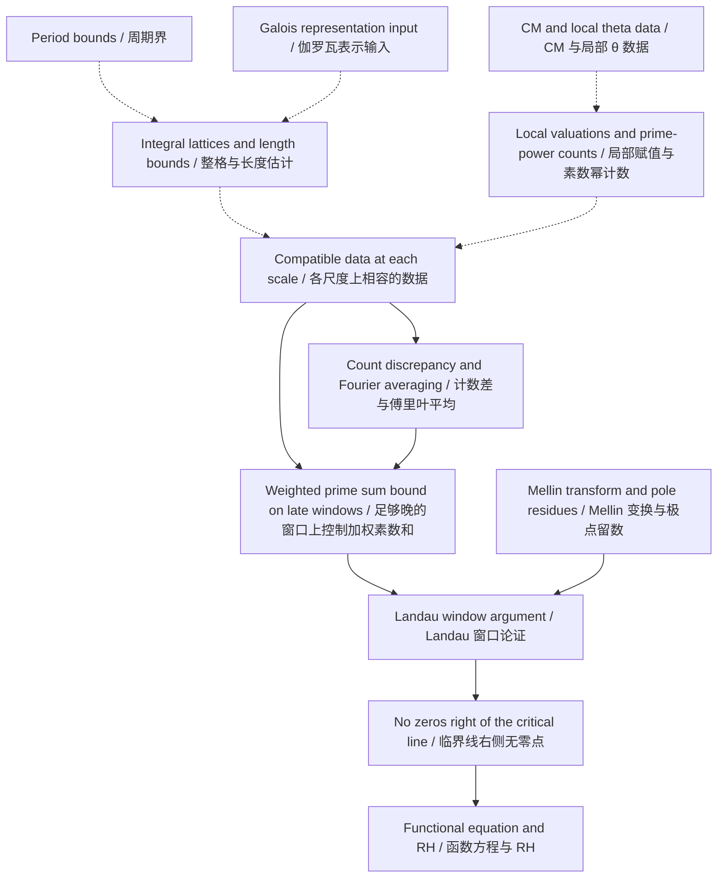

# Proof map / 证明总览图

[English home](README.md) · [中文首页](README.zh-CN.md) · [Review status / 复核状态](STATUS.md)

Read the arrows as dependencies between groups of arguments. Solid arrows correspond to steps explained in the notes under the stated hypotheses. Dashed arrows mark upstream connections still being assembled in prose. The analytical implication is developed in the notes for RH. Follow the pinned Lean statement and the verification report for the full RH and Dirichlet GRH conclusions.

实线表示笔记已展开的推导，各步仍须满足正文列出的假设。虚线表示文字稿仍在串联的上游联系。图中解析段的阅读入口以 RH 为例，RH 和狄利克雷 GRH 的最终陈述可在固定版本的 Lean 源码及核验报告中查阅。

## Three inputs to Dirichlet nonvanishing

The Lean theorem `every_character_of_green_v_win` takes three inputs.

1. **Finite-field characters (`Green`).** Classify cuspidal characters of finite general linear groups using polynomial labels and obtain their values on elements with irreducible characteristic polynomial. [Deduction from Green's classical theorem](proofs/en/green-cuspidal-characters-by-polynomial-labels.md) · [Why the Lean construction exhausts the cuspidal characters](proofs/en/counting-exhausts-the-cuspidal-characters.md)
2. **A cohomological window (`VWin`).** Bound the lengths of localization kernels throughout a common interval for the relevant abelian fields. This supplies candidate data for the window argument. [Window proof from the signed and dyadic bounds](proofs/en/cohomological-window.md)
3. **Existence of compatible definite-side data (`HypsAlt`).** Construct a family on which the theta, local matching, and lattice estimates can be used together. This input and `Green` give the family comparison used in the prime-sum bound. [Lean construction](https://github.com/tamnd/riemann-lean/blob/9110120cdc195ee8d2fb08d2adac8b1747912d8f/lean/src/Development/AutomorphicArithmetic/ThetaCorrespondence/ThetaPairLifts/ThirdPlaceSeries/SiegelEisensteinSecondTermHypotheses.lean#L44-L67) · [Unfinished links in the exposition](STATUS.md#upstream-links-to-complete--待串联的上游证明)

The cohomological and definite-side arguments share the construction of Galois representations with local–global compatibility (`Row0b`). The analytical deduction from the window bound uses the three assembled inputs. [Shared Galois input](https://github.com/tamnd/riemann-lean/blob/9110120cdc195ee8d2fb08d2adac8b1747912d8f/lean/src/Development/AutomorphicArithmetic/CharacterBoxes/MainConclusion.lean#L7-L11) · [Lean theorem with three inputs](https://github.com/tamnd/riemann-lean/blob/9110120cdc195ee8d2fb08d2adac8b1747912d8f/lean/src/Development/AutomorphicArithmetic/ThetaCorrespondence/ThetaPairLifts/ThirdPlaceSeries/TopPlug.lean#L12-L18) · [Tam Nguyen Duc's guide to the same chain](https://riemann.tamnd.com/proof/trunk/)

## Dependencies in the exposition

## What to read / 对应篇目

| Step / 环节 | Notes / 笔记 |
| --- | --- |
| Period values and lattices / 周期与格 | [Period valuations to an integral lattice map](proofs/en/integral-lattice-map.md) · [中文导读](proofs/zh/integral-lattice-map.md) |
| Local theta estimates / 局部 θ 估计 | [All-place theta expansion from host integrality](proofs/en/from-host-integrality-to-the-all-place-theta-expansion.md) · [From orbit valuations to the prime-power count](proofs/en/from-orbit-valuations-to-the-prime-power-count.md) |
| Assembly at all scales / 各尺度上的组装 | [Common window](proofs/en/common-window.md) · [Assembling pointwise witnesses into one window family](proofs/en/assembling-a-window-family.md) · [共用窗口](proofs/zh/common-window.md) |
| Counts to prime sums / 从计数到素数和 | [Quotient slopes and count discrepancy](proofs/en/quotient-slopes-and-count-discrepancy.md) · [Translation averaging](proofs/en/translation-averaging.md) |
| Window criterion / 窗口判据 | [From window estimates to RH](proofs/en/from-windows-to-rh.md) · [Pole data](proofs/en/pole-data.md) · [Landau window lemma](proofs/en/landau-window.md) · [中文导读](proofs/zh/from-windows-to-rh.md) |
| Final statements / 最终陈述 | [Pinned Lean source](https://github.com/tamnd/riemann-lean/blob/9110120cdc195ee8d2fb08d2adac8b1747912d8f/lean/src/Main.lean) · [Independent verification report](https://math.mit.edu/~drew/grh/) |

The [status page](STATUS.md#upstream-links-to-complete--待串联的上游证明) has the Lean entry points for the simultaneous construction, the actual period bounds, and the Galois input.

[进度页](STATUS.md#upstream-links-to-complete--待串联的上游证明)给出了数据共同构造、实际周期界和伽罗瓦输入在 Lean 中的入口。
